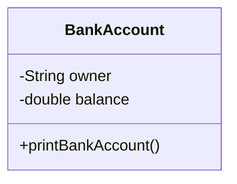
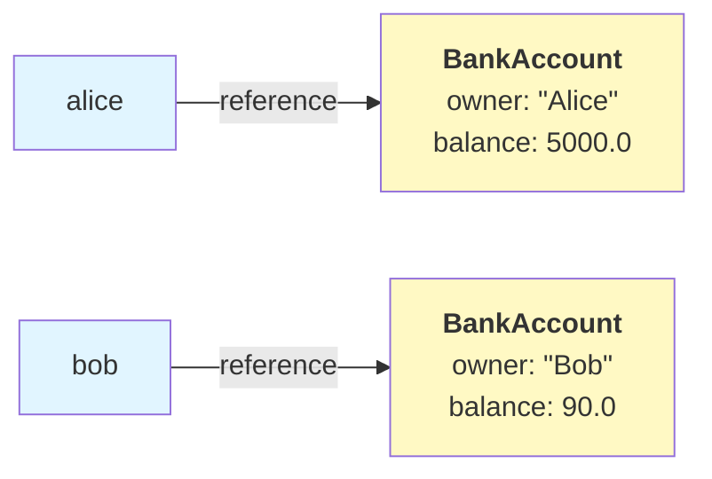
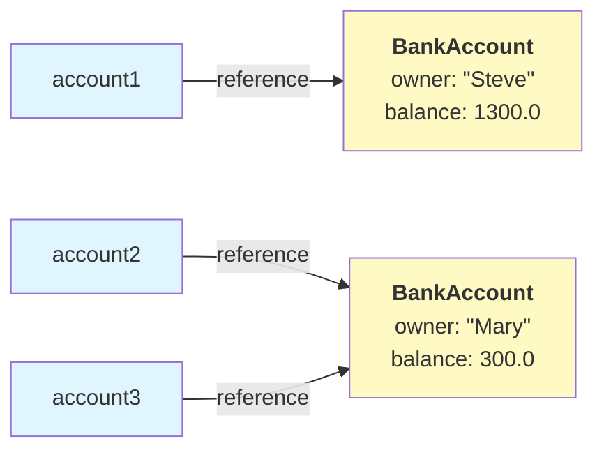

# Classes and objects

## What is a class?

- A **class** is a blueprint or template for creating objects
- It defines the **structure** (what data it contains) and **behavior** (what actions it can perform) that objects created from the class will have
- We can think of a class as a blueprint for a house: the blueprint defines the rooms, doors, and windows, but the actual house is built based on that blueprint
- In Java, each class is defined in its own file, named by the class name, e.g. `BankAccount.java`
- An application typically **consists of multiple classes**, each with a specific responsibility. Together, these classes provide the functionality required by the application



```java
// This is a class named BackAcount in BankAccount.java file
// It serves as a blueprint for creating bank account objects
public class BankAccount {
    // Data (attributes)
    private String owner;
    private double balance;

    // Behavior (methods)
    public void printBankAccount() {
        System.out.println("Owner: " + this.owner + ", balance: " + this.balance + "€");
    }
}
```

## What is an object?

- An **object** is a concrete **instance** of a class
- It is created based on the class blueprint and contains actual data
- While a class is abstract (just a template), an object is concrete (an actual thing in memory)
- Multiple objects can be created from the same class, each with different data

```java
// Here, the Application class in the Application.java file uses the BankAccount class
public class Application {
    public static void main(String[] args) {
        // The account variable contains an object created form the BankAccount class
        BankAccount account = new BankAccount();
    }
}
```

## Creating objects - the `new` keyword

- To create an object from a class, we use the `new` keyword
- The `new` keyword **allocates memory** for the new object and calls a **constructor** (a special method that initializes the object)
- After cration, the object is assigned to a variable, which stores a reference to that object

$$
\underbrace{\texttt{BankAccount}}_{\text{class type}}
\quad
\underbrace{\texttt{account}}_{\text{variable name}}
\quad
\texttt{=}_{}
\quad
\underbrace{\texttt{new BankAccount()}}_{\text{create new object and call constructor}}
$$

```java
// Create an object from the BankAccount class
BankAccount account = new BankAccount();
// Create a LocalDate object (a built-in Java class)
LocalDate birthday = LocalDate.parse("1993-01-19");
```

## Constructor

- A **constructor** is a special method that is called automatically when creating an object with the `new` keyword
- The constructor's purpose is to **initialize the object** by setting initial values for its attributes
- A constructor has the **same name as the class** and **no return type** (not even `void`)
- If we don't define a constructor, Java automatically provides a default empty constructor

```java
public class BankAccount {
    private String owner;
    private double balance;

    // Constructor: called automatically when creating a BankAccount object
    public BankAccount(String owner, double balance) {
        // "this" refers to the current object
        // We are assigning the attribute values based on the constructor arguments
        this.owner = owner;
        this.balance = balance;
    }

    public void printBankAccount() {
        System.out.println("Owner: " + this.owner + ", balance: " + this.balance + "€");
    }
}
```

## Constructor example

- When we create an object, we must provide the required parameters for the constructor

```java
// Create a BankAccount object with owner "Alice" and balance 5000
BankAccount alice = new BankAccount("Alice", 5000);
// Create a BankAccount object with owner "Bob" and balance 90
BankAccount bob = new BankAccount("Bob", 90);

// alice and bob objects have different attribute values, which we will see in the output
alice.printBankAccount();
bob.printBankAccount();
```

```
Alice: 5000.0€
Bob: 90.0€
```



## Methods and accessing attributes

- Methods are actions that an object can perform
- Methods are defined in the class and belong to the objects created from that class
- To call a method on an object, we use the dot `.` operator: `objectName.methodName()`
- Methods can access and modify the object's attributes using `this` keyword

```java
public class BankAccount {
    private String owner;
    private double balance;

    public BankAccount(String owner, double balance) {
        this.owner = owner;
        this.balance = balance;
    }

    // "Getter" (getting an attribute value) and "setter" (setting an attribute value) methods are common methods for each class
    public double getBalance() {
        // "this" refers to the current object, this.balance is the value of the balance attribute
        return this.balance;
    }

    public void setBalance(double balance) {
        // We assign a new value for the balance attribute
        this.balance = balance;
    }

    public void deposit(double amount) {
        this.balance = this.balance + amount;
    }

    public void withdraw(double amount) {
        this.balance = this.balance - amount;
    }

    public void printBankAccount() {
        System.out.println("Owner: " + this.owner + ", balance: " + this.balance + "€");
    }
}
```

```java
BankAccount alice = new BankAccount("Alice", 5000);
BankAccount bob = new BankAccount("Bob", 90);

// Calling the withdraw method, will decrease the balance attribute of the alice object
alice.withdraw(500);
// Calling the deposit method, will increase the balance attribute of the bob object
bob.deposit(1000);

System.out.println(alice.getBalance());
System.out.println(bob.getBalance());
```

```
4500.0
1090.0
```

## String presentation of objects

- The `toString` method is a special method that returns a **string representation** of an object
- Every class inherits a `toString` method from the base class `Object`, but it returns a cryptic default representation

```java
BankAccount alice = new Person("Alice", 5000);
System.out.println(alice);
```

```
BankAccount@15db9742
```

## Controlling the string presentation with toString method

```java
public class BankAccount {
    private String owner;
    private double balance;

    public BankAccount(String owner, double balance) {
        this.owner = owner;
        this.balance = balance;
    }

    // Override the toString method to return the desired string presentation of the object
    @Override
    public String toString() {
        return "Owner: " + this.owner ", balance: " + this.balance + "€";
    }

    // ...
}
```

```java
BankAccount alice = new Person("Alice", 5000);
// The println method transforms the object to string by calling the toString method
System.out.println(alice);
```

```
Owner: Alice, balance: 5000.0€
```

## Object references

- When we create an object with `new`, the variable doesn't store the object itself—it stores a **reference** to the object in memory
- A reference is like an address or pointer to where the object is stored amd **multiple variables can refer to the same object**
- The `==` operator compares **references**, not e.g. the attribute contents of the objects

```java
BankAccount account1 = new BankAccount("Steve", 1300);
BankAccount account2 = new BankAccount("Mary", 300);
// Now account1 and account2 point to the same object
BankAccount account3 = account2;

System.out.println(account1);
System.out.println(account2);
System.out.println(account3);

// account1 and account2 variables point to a different object
System.out.println(account1 == account2);
// account2 and account3 variables point to the same object
System.out.println(account2 == account3);
```

```
Owner: Steve, balance: 1300.0€
Owner: Mary, balance: 300.0€
Owner: Mary, balance: 300.0€
false
true
```



## `null` reference

- A variable can hold a `null` reference, meaning it doesn't refer to any object
- Attempting to access attributes or methods on a `null` reference causes a `NullPointerException`

```java
// account doesn't refer to any object
BankAccount account = null;

// We're trying to access an attribute on something that doesn't exist
System.out.println(account.getBalance()); // NullPointerException!

// We should check if the reference is null first
if (account != null) {
    System.out.println(account.getName());
}
```

## Method and attribute visilibity

- Where a method can be called and where an attribute can be accessed is controlled by the `private` and `public` keywords specified at the beginning of a method or attribute definition
- A `public` method or attribute can be **called and accessed anywhere**, e.g. in the `main` method of the program
- In contrast, a `private` method or attribute can **only be called and accesssed within the class itself** and not outside it, e.g. in the `main` method of the program
- The general rule is to keep attributes private and only make methods necessary to be used outside the class public

```java
public class BankAccount {
    // Attributes should be kept private, only accessible within the class
    private String owner;
    private double balance;

    public BankAccount(String owner, double balance) {
        this.owner = owner;
        this.balance = balance;
    }

    // Private method can only be called within the class
    private String formatBalance() {
        return this.balance + "€";
    }

    public void printBankAccount() {
        // We can call the formatBalance here, because we are in a method of the same class
        System.out.println("Owner: " + this.owner + ", balance: " + this.formatBalance());
    }

    // ...
```

```java
BankAccount steve = new BankAccount("Steve", 1300);
// WON'T WORK, we can't call a private method outside the class itself
System.out.println(steve.formatBalance());
// WORKS, we can call a public method anywhere in the program
steve.printBankAccount();
```

## List of objects

- The type parameter used in creating a list defines the type of the variables that are added to the list
- For example, `List<String>` includes strings, `List<Integer>` integers, and `List<Double>` floating point numbers
- Strings are objects, so it should come as no surprise that other kinds of objects can also be found in lists, for example `List<BankAccount>` includes `BankAccount` object

```java
BankAccount alice = new BankAccount("Alice", 5000);
BankAccount bob = new BankAccount("Bob", 90);
BankAccount steve = new BankAccount("Steve", 1300);
BankAccount mary = new BankAccount("Mary", 300);

// Initialize a list of BankAccount objects
List<BankAccount> accounts = new ArrayList<>();
accounts.add(alice);
accounts.add(bob);
accounts.add(steve);
accounts.add(mary);

for (BankAccount account : accounts) {
    System.out.println(account);
}
```

```
Owner: Alice, balance: 5000.0€
Owner: Bob, balance: 90.0€
Owner: Steve, balance: 1300.0€
Owner: Mary, balance: 300.0€
```
